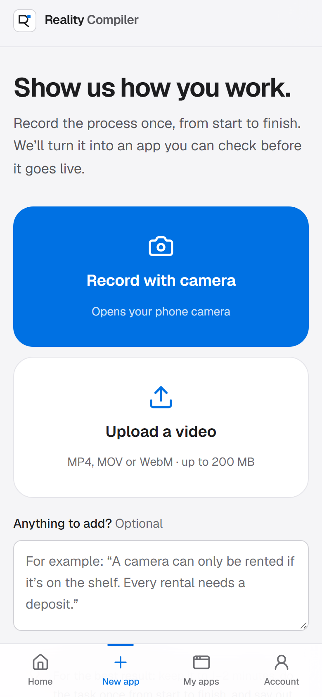
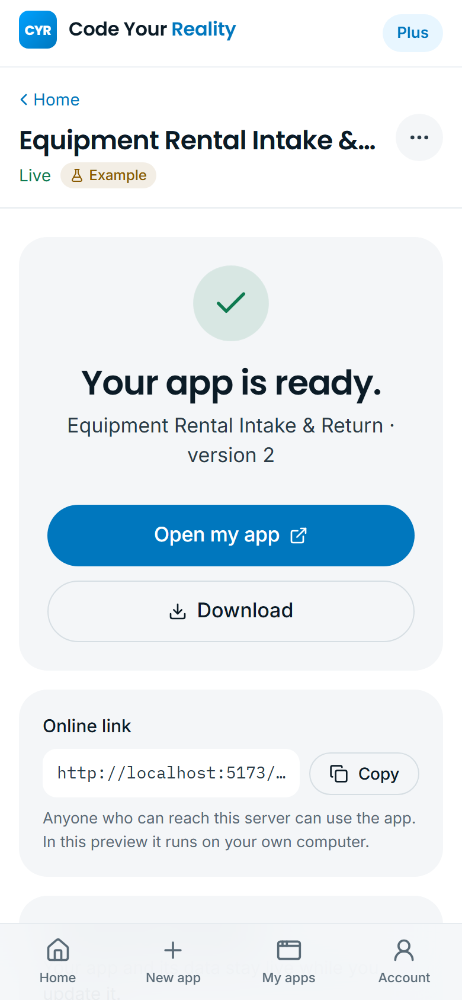
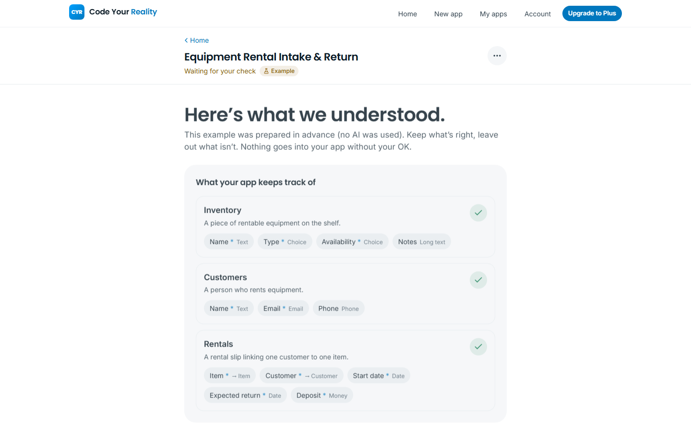
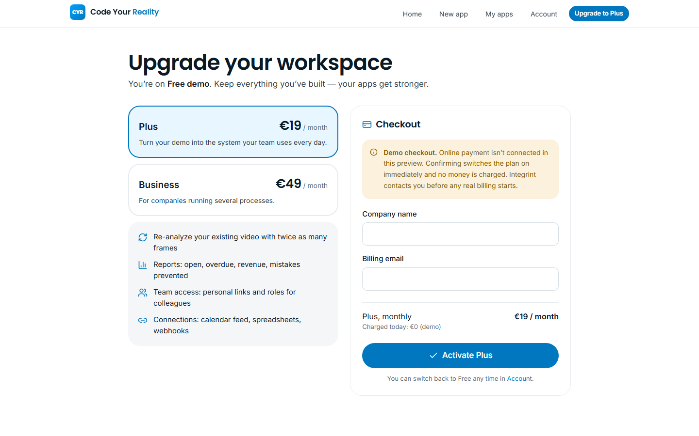
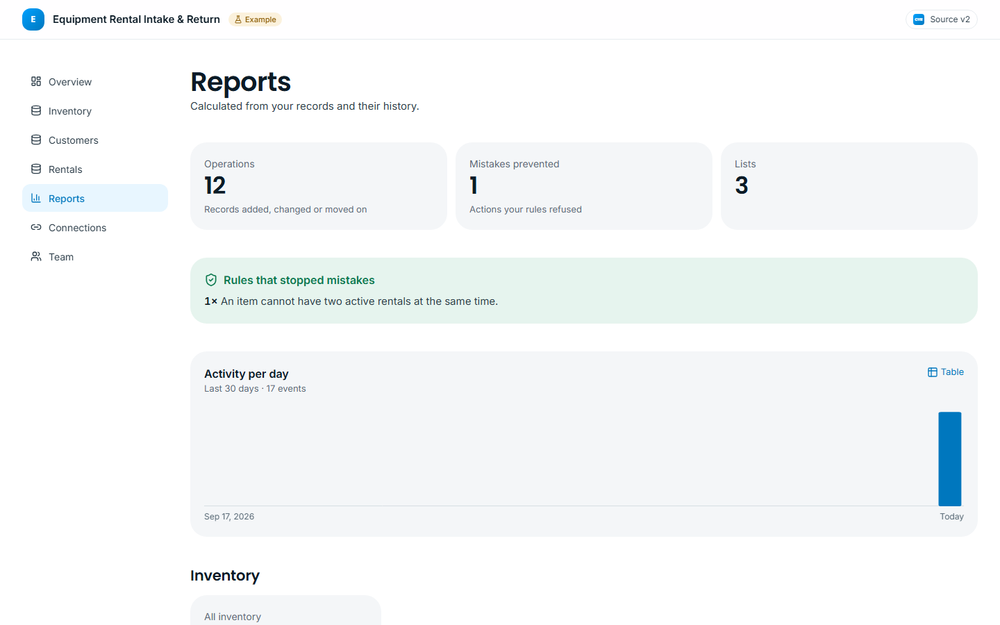
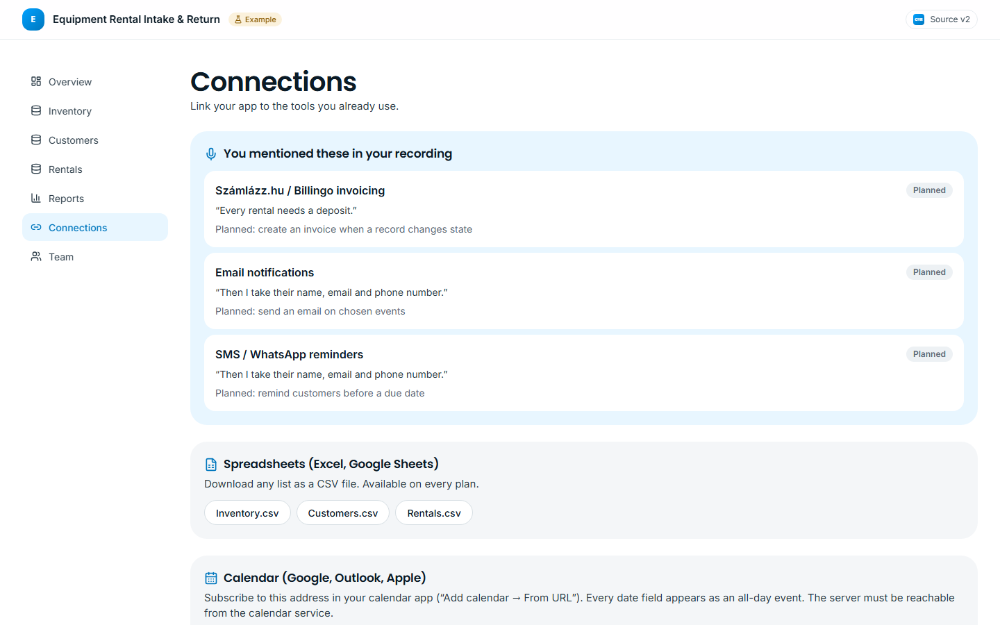

# Code Your Reality

**Film how you work. Get your own app.**
*By Integrint. Don't describe your workflow. Show it.*

Code Your Reality turns a recorded business process into a working application. A small business owner films how the work is done with a phone. **Google's open-weight Gemma 4 model, running locally through Ollama**, proposes the process structure: what is tracked, how things move along, and the business rules. Each finding is traced back to the second of the recording it came from. The owner keeps or drops each finding in plain language. The approved workflow then compiles into a schema-driven application that actually runs: records persist, and the server enforces the business rules on every operation. When the business changes, the owner records again or asks for a small change in one sentence.

**Customer journey:** see how it works → pick a plan (free pilot) → record with the phone camera → the AI analyzes it → review in plain language → the app is built → open it with a link or download it → record again or request small changes → support from Integrint.


## Screenshots

| | |
| --- | --- |
|  |  |
| **Record** on the phone: one big camera button that opens the native camera. | **Ready**: open the app, download it, share the link, record again, or ask for a small change. |
|  |  |
| **Review in plain language**: keep or leave out each finding. AI guesses are flagged. | **Upgrade to Plus**: a demo checkout (no payment is taken) switches the plan on. |
|  |  |
| **Reports** (Plus): open and overdue items, totals, busiest items, and mistakes your rules prevented. | **Connections** (Plus): tools you mentioned in the video, a calendar feed, CSV export, and webhooks. |
|  |  |
| **Operate**: the generated app, with records persisted on the server. | **Rules are enforced server-side**: renting an item twice is refused, and the reason names the rule. |

Regenerate the screenshots with `node scripts/screenshots.mjs` from `frontend/` while both dev servers are running.

---

## Why this is different

| Typical "AI app builder" | Code Your Reality |
| --- | --- |
| Starts from a written prompt or spec | Starts from **evidence of real work**: video, speech, narration |
| AI output is treated as the answer | AI output is a **proposal**. Every item is pending until a human confirms it |
| Generates and runs code | Produces a **constrained, validated definition** that a predefined runtime interprets. No model-generated code is ever executed |
| Rules live in prose | Rules compile into **server-enforced guards, invariants and effects** |
| No provenance | **Evidence Intelligence**: each rule links to its transcript segment or video frame, with an audit trail of human decisions |

## What works today

- **Landing page** (light, Apple-inspired): how it works in four steps, an **interactive in-page rental preview** (the same rule kinds, run in the browser on throwaway data, and labelled as such), **monthly plans**, and **support by Integrint**.
- **Simple Studio** built mobile-first: Home (your apps), New app, My apps, Account (plan, Integrint support, AI engine status). On phones it uses a bottom tab bar.
- **Simple flow per app:** a friendly progress screen while the AI works → a plain-language review (keep or leave out each entity, field, button and rule, with the quote it came from) → **Build my app** → a ready screen with **Open my app**, **Download** (ZIP: definition, CSV and JSON data, history), the online link (copy and share), **Record again**, and **Ask for a small change**.
- **Small change requests:** a sentence of up to 300 characters ("Customers should also give an email address") becomes at most five constrained edits (add, rename or remove a field, make it required, add an option, add or remove a rule). They come back for review as a new version. Large or unclear requests are refused, not guessed.
- **Record again:** a new video creates a new workflow version. The live app keeps running until the update is confirmed, and its records are kept.
- **Plans (Free demo → Plus → Business):** limits are enforced on the server: number of apps, video analyses per month, frames per analysis, and access to Reports, Connections and Team. The **Free demo** builds one app. **Plus** re-analyzes the *same* video more deeply (12 frames instead of 6) and unlocks the features below. Upgrading goes through a **demo checkout**: company name and billing email only, no card data, nothing charged. The UI says so everywhere.
- **Reports (Plus):** operations, mistakes prevented by rules (and which rules), activity per day, open/closed and average time to complete, overdue items (detected from due/return date fields), totals and averages for money fields, breakdowns by status or choice, and the most frequent linked records. Every chart has a table view and hover details.
- **Connections (Plus):** the tools you **mention in your video** are detected from the transcript and narration, with the quote and timestamp. Available now: CSV export per list (all plans), an **ICS calendar feed** of every date field (Google Calendar, Outlook, Apple Calendar), and **webhooks** signed with HMAC-SHA256 (Zapier, Make, own systems). Invoicing (Számlázz.hu / Billingo), email, SMS/WhatsApp and webshop sync are shown as *planned*.
- **Team access with roles (Plus):** make an app private, then give each colleague a personal link with a role: owner, manager, staff or viewer. Every API call is checked against the role on the server, and the UI hides what a role can't do.
- **Capture**: drag-and-drop upload with client and server validation (container magic bytes, size, duration), upload progress with cancel, preview, remove/replace, **browser recording** (camera or screen plus microphone) with permission and error handling, an optional written narration, a privacy notice, and transcript editing.
- **Observe**: a real background job with persisted stages: media received → audio extraction → transcription → frame sampling → model interpretation (two passes) → structured validation. The UI shows exactly what the backend reports. There are no invented percentages or time estimates.
- **Understand**: a three-panel workspace. Evidence (video or storyboard, frames, transcript) on the left, workflow structure (process canvas, entities, lifecycle, rules, actions, open questions) in the center, and a contextual **inspector** with structured editors on the right. Edits auto-save as new workflow versions.
- **Verify**: review every finding (confirm, reject, or reopen) and approve. Approval is refused server-side while anything is pending or invalid.
- **Compile**: a real compiler with six measured stages. The **application assembly** panel is built from the compiled manifest.
- **Operate**: the generated app at `/apps/:slug` has a dashboard, a list for each entity (table on desktop, cards on mobile), generated create and edit forms, a detail view with history, guarded transitions with confirmation, an activity feed that includes rule rejections, sample-data seeding, and a clear-data action behind a confirmation dialog.
- **Evidence & audit page**: an evidence index for every cited finding, and an audit trail of model, compiler and reviewer actions.

### The first supported workflow: equipment rental

Inventory (name, type, availability, notes), customers (name, email, phone) and rentals (item, customer, start date, expected return, deposit, status, returned-on date). The server enforces these rules:

1. An unavailable item cannot be rented (`ref_field_equals` guard).
2. An item cannot have two active rentals (`exclusive_reference` invariant).
3. Starting a rental marks the item as rented (`set_ref_field` effect).
4. Completing a return makes the item available again (`set_ref_field` effect).
5. Completing a return records the return date (`set_field` effect).
6. A deposit cannot be negative (`min_value`). The expected return can't be before the start date (`date_order`).
7. Invalid state transitions are rejected with HTTP 409. Workflow-owned fields (state, effect targets, locked references) can't be edited by hand.

The same runtime runs **any** workflow that compiles. The AI pipeline was tested on a different domain (a tool-lending workshop), and the workflow editor can define new ones by hand.

## Two demo paths

**Path A: Instant guided demo (no AI model needed).** Choose *Try the demo* on the homepage or in the Studio. This loads a **predefined example**: a narrated rental-counter walkthrough, shown as an illustrated storyboard in the advanced editor, with an authored workflow. The UI marks it "Example" everywhere and never presents it as model output. Review it, build it, operate it.

**Path B: Analyze my workflow.** Upload or record real media. The backend runs FFmpeg, faster-whisper and a local Ollama model. If the model is unavailable, or its answer can't be mapped to a supported workflow, the job fails and says why, and you can retry or continue from the rental template or a blank workflow.

## Architecture

```
Observed process (video · speech · narration)
   │  FFmpeg: probe, extract 16 kHz audio, sample N frames
   │  faster-whisper: timestamped transcript (editable)
   ▼
Model (Ollama-compatible, open-weight, multimodal)
   │  Pass A  (frames + numbered source segments) → entities, fields, lifecycle, steps, questions
   │  Pass B  (text; JSON schema generated from Pass A) → rules (one schema per rule kind), actions
   ▼
Normalization (untrusted input)   keys re-derived · references checked · citations → timestamps/quotes
   ▼                              unmappable rules downgraded to documented notes · everything "pending"
Workflow definition v1..n (Pydantic / Zod)  ── human review, edits, audit trail ──▶ approval
   ▼
Compiler  validate_schema → build_models → prepare_forms → wire_transitions → activate_runtime → ready
   ▼
Manifest (pure data)  ──▶  Predefined runtime  (closed set of rule kinds, per-app write lock, event log)
   ▼
Generated application  /apps/:slug   (records persisted in SQLite)
```

**Safety by construction.** The model only ever produces JSON constrained by a schema. That JSON is normalized, validated, reviewed and compiled into a manifest. The runtime interprets a *closed* set of parameterized rule kinds (`ref_field_equals`, `exclusive_reference`, `set_ref_field`, `set_field`, `min_value`, `date_order`, plus non-enforced `note`). No Python, JavaScript, SQL or shell from a model or a workflow definition is ever executed.

### Repository layout

```
backend/
  app/
    main.py                FastAPI app, error handling, capabilities
    config.py              environment configuration (RC_*)
    db.py                  SQLAlchemy models (projects, media, workflow versions, jobs, apps, records, events, audit)
    api/projects.py        projects, media upload/stream, transcript, analysis, workflow versions, approval, compile, audit
    api/apps.py            generated application runtime API
    pipeline/media.py      FFmpeg probing, audio extraction, frame sampling, container sniffing
    pipeline/transcribe.py faster-whisper
    pipeline/model.py      Ollama provider, two-pass constrained extraction
    pipeline/normalize.py  untrusted output → reviewable workflow definition
    workflow/schema.py     the workflow definition (Pydantic)
    workflow/validation.py semantic validation and review gating
    workflow/compiler.py   definition → manifest
    workflow/runtime.py    manifest interpreter with rule enforcement
    workflow/sample.py     predefined sample and rental template (always labelled)
    services/jobs.py       background analysis and compile jobs with persisted stages
  tests/                   pytest: core workflow, rules, uploads, pipeline failure, normalization
frontend/
  src/pages/               Landing, Studio pages, project steps, generated app
  src/components/          design system, studio (CompilerCore, WorkflowCanvas, Inspector, Evidence, Capture), app runtime UI
  src/lib/                 API client, Zod workflow schema, queries, workspace store
  e2e/                     Playwright: full guided journey, smoke tests on desktop and mobile
docs/demo-script.md        60–90 s jury walkthrough
```

### Technical stack

- **Frontend:** React 19, TypeScript, Vite, Tailwind CSS v4, React Router, Motion for React, TanStack Query, Zustand, React Hook Form, Zod, Lucide icons, Geist / Instrument Serif / IBM Plex Mono (self-hosted via Fontsource)
- **Backend:** Python 3.12, FastAPI, Pydantic v2, SQLAlchemy 2, SQLite (WAL), FFmpeg via `imageio-ffmpeg` (or system FFmpeg), faster-whisper, Ollama HTTP API
- **AI model (default): `gemma4:e4b`, Google's open-weight Gemma 4**, via Ollama. It's multimodal: the sampled video frames and the transcript go into the same request. It's used for both the two-pass extraction and the small change requests. `qwen3.5:4b` was also tested and still works (`RC_OLLAMA_MODEL`). The backend checks that the model is installed and which capabilities it has (vision, thinking), then adapts or reports the problem.
- **Tests:** pytest, Vitest and React Testing Library, Playwright

## Setup (Windows PowerShell)

Prerequisites: Python 3.11+ (3.12 tested), Node.js 20+ (24 tested), and optionally [Ollama](https://ollama.com) for Path B.

```powershell
# 1. Backend
cd backend
python -m venv .venv
.\.venv\Scripts\python.exe -m pip install --upgrade pip
.\.venv\Scripts\python.exe -m pip install -r requirements.txt
.\.venv\Scripts\python.exe -m uvicorn app.main:app --host 127.0.0.1 --port 8000
```

```powershell
# 2. Frontend (second terminal)
cd frontend
npm install
npm run dev
```

Open http://localhost:5173. The Vite dev server proxies `/api` to the backend.

```powershell
# 3. Optional, for Path B: a local multimodal model
ollama pull gemma4:e4b
# then check Studio → Settings shows the model as installed with vision
```

Configuration is optional: copy `.env.example` to `.env` and adjust the `RC_*` variables (model, Ollama URL, limits, Whisper model, FFmpeg path). FFmpeg doesn't need a separate install, because `imageio-ffmpeg` ships a binary. The first transcription downloads the faster-whisper weights (`base`, about 145 MB) from Hugging Face.

macOS/Linux: use `.venv/bin/python` instead of `.\.venv\Scripts\python.exe`.

## Running on a server (Docker, Ollama Cloud)

One container serves the frontend and the API, with FFmpeg and faster-whisper (CPU, int8) inside. The AI model is reached over HTTP: Ollama Cloud with an API key, or a local Ollama.

```bash
cp .env.example .env   # OLLAMA_URL=https://ollama.com, OLLAMA_API_KEY=..., OLLAMA_MODEL=..., BASIC_AUTH_*
docker compose up -d --build
curl http://localhost:8000/health
```

The API key is read only by the backend from the environment. It's git-ignored, excluded from the Docker build context, and never returned by any endpoint. Full guide, including HTTPS with Caddy (needed for camera recording), local Ollama in Compose, backups and limits: [docs/deploy.md](docs/deploy.md). A GitHub Actions workflow builds the image and smoke-tests `/health`, the frontend, the API and FFmpeg/faster-whisper on every push.

## Running the guided demo

1. Start both servers and open http://localhost:5173.
2. Click **Try the demo**. The plain-language review opens.
3. Leave out the AI-guessed rule "Late returns may incur a fee", then click **Build my app**.
4. On the ready screen, click **Open my app**. (Download, the online link, Record again and small changes are offered there too.)
5. Click **Add sample records**. Create a rental for the Canon EOS R6, and its availability flips to *rented*. Try renting it again, and the server refuses. Click **Complete return**, and the item is available again. Reload the page: everything persists.
6. Optional: open **⋯ → Advanced editor** to see the storyboard, transcript and evidence linking. Clicking a rule highlights the narration it came from.

## Running AI processing (Path B)

1. Make sure Ollama is running and the configured model is installed (Studio → Settings).
2. Studio → **New app**: record with the camera (on a phone it opens the native camera) or upload a short clip (MP4/MOV/WebM/MKV, ≤ 200 MB, ≤ 5 min) or record your camera or screen, and optionally add a narration.
3. Click **Create my app** and watch the real job stages.

**Measured on the development laptop** (Intel Core Ultra 7 155U, 15 GB RAM, CPU only), with a 48-second narrated clip about lending tools in a community workshop. This deliberately isn't the rental domain the sample uses:

| Model | Analysis time | Result |
| --- | --- | --- |
| `gemma4:e4b` (default) | ~8.4 min | Tool, Member and Loan with correct references; loan lifecycle; 9 rules, all citing transcript timestamps; enforceable deposit and date rules |
| `qwen3.5:4b` | ~6.5 min | Entities found, but the lifecycle was attached to the wrong entity |
| `gemma4:e4b`, change request | 50 s | "Members should also give an email address, and it is required" became one new required field |
| `gemma4:e4b`, oversized request | 46 s | "Build me a complete accounting system…" was refused, and nothing was changed |
4. Review the proposal in the workspace. Items the model cited show their transcript quote and timestamp, and claims of direct evidence without a citation are downgraded to *AI inference*. Correct whatever is wrong, approve, and compile.

### Choosing a model

The default `gemma4:e4b` (about 7 GB with its vision projector) runs on a 16 GB laptop without a GPU. Any Ollama model whose capabilities include `vision` can be configured:

```powershell
ollama pull <vision-model>
$env:RC_OLLAMA_MODEL = "<vision-model>"   # or set RC_OLLAMA_MODEL in .env
```

Studio → Account → AI engine shows whether the configured model is installed and has vision. The guided demo (Path A) doesn't use a model at all.

## Testing

```powershell
cd backend;  .\.venv\Scripts\python.exe -m pytest -q          # 18 tests: rental cycle, rules, uploads, failure handling, normalization, change requests, export, plans, roles, reports, calendar, webhooks
cd frontend; npm run typecheck                                 # TypeScript (tsc -b)
cd frontend; npm test                                          # 9 Vitest tests: schema helpers, workflow ops, SchemaForm
cd frontend; npx playwright install chromium; npm run test:e2e # 17 Playwright tests: guided journey, Plus upgrade with team roles, advanced editor, desktop/mobile smoke
```

Playwright starts its own backend (:8001, temporary data directory) and Vite server (:5174), so tests never touch your development data.

## Limitations (honest)

- **Billing:** plans and their limits are real, but payment is not connected. Upgrades use a clearly labelled demo checkout that charges nothing. Connecting Stripe or Barion is the next step.
- **Single workspace, no login for the Studio:** the Studio is the owner's console (local, single-tenant). Team roles protect the generated apps through personal access keys, not user accounts.
- **Online link:** the app link works for anyone who can reach the server. In this local build that means your own computer or network. Public hosting is a deployment step that isn't included here.

- **Model quality depends on the model you run.** With small local models, extraction of entities and lifecycles is usually good, but rule mapping is less consistent (Gemma 4 E4B mapped 2 of 9 rules to enforceable kinds on our test clip). Rules that can't be mapped to an enforceable kind are kept as documented notes for you to fix in the inspector. Nothing is compiled without human review.
- **Transcription is English-first** with the default `base` Whisper model. Choose a larger or multilingual model with `RC_WHISPER_MODEL`.
- **Rule language is intentionally small:** preconditions on linked records, exclusivity, effects, minimums and date order. Arbitrary logic such as fees or calculations is recorded as notes, not enforced.
- **Single-process deployment.** Rule checks are serialized per application with an in-process lock. Running several backend workers would need database-level locking.
- **Recompiling** updates the manifest in place and keeps existing records. Removing a field leaves the old values stored but hidden.
- Jobs don't survive a server restart. Interrupted jobs are marked failed and can be retried.
- There is no authentication or multi-user support. This is a local, single-user build.
- The sample's "video" is an illustrated storyboard with an example narration, not a camera recording, and it's labelled as such.

## Security & privacy

- Uploads are checked by magic bytes, not by the file name or MIME type the client sends. They're size-limited while streaming and duration-limited after probing, and stored under server-generated names (the original name is display metadata only, so path traversal isn't possible).
- FFmpeg is invoked with argument lists, never through a shell.
- Model output, transcripts and workflow definitions are treated as untrusted. They're validated with Pydantic on the server and Zod in the client, and interpreted by a closed runtime.
- CORS is restricted to the configured origins. No secrets are stored in the frontend, and configuration comes from environment variables.
- Media and derived frames stay on your machine. Frames and text are sent only to the model server you configure. Deleting a project deletes its media, frames, workflow versions, audit trail and compiled application.

## Roadmap

- Multi-workflow templates (work orders, inspections, intake forms) and composite rules (`all/any`)
- Calculated fields and fee rules with an explicit, sandboxed expression language
- Model comparison: run two models and diff their proposals side by side
- Timeline view correlating every detected step with the video
- Role-based access, multi-user review, and export of compiled apps as standalone services
- Postgres support with row-level locking for multi-worker deployments

---

See [docs/demo-script.md](docs/demo-script.md) for the 60–90 second jury walkthrough.

## License

© 2026 Integrint Kft. All rights reserved. The code is public for viewing and evaluation only (including by the Hacktoberfest challenge judges). Any other use needs written permission. See [LICENSE](LICENSE). Third-party dependencies and AI models keep their own licenses.
