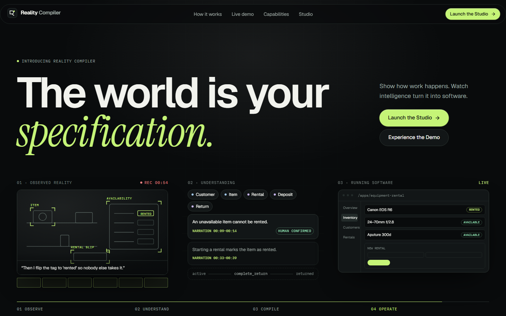
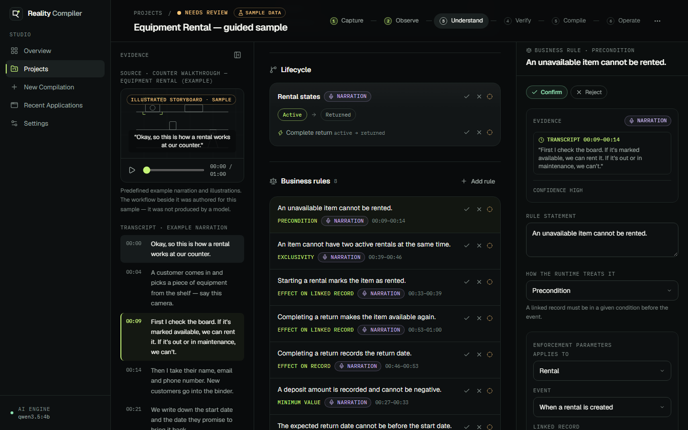
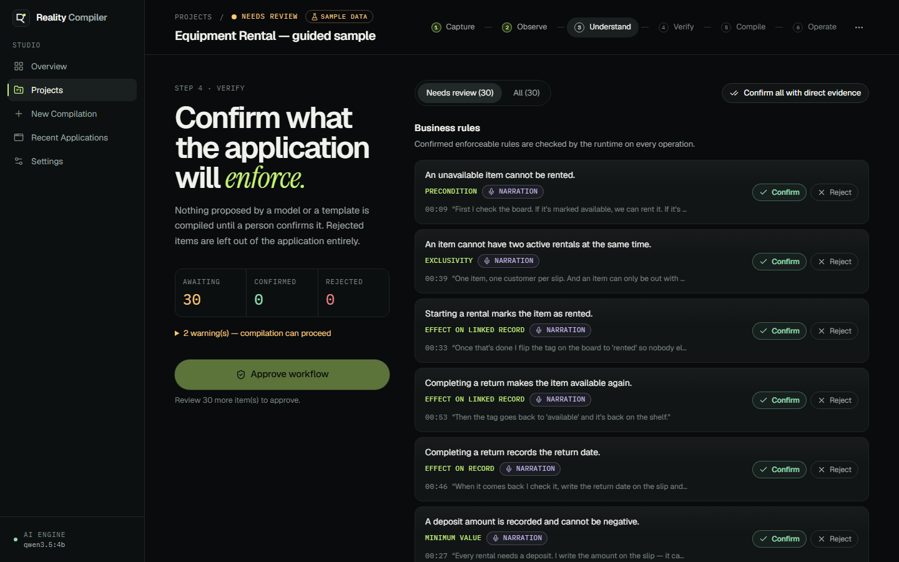
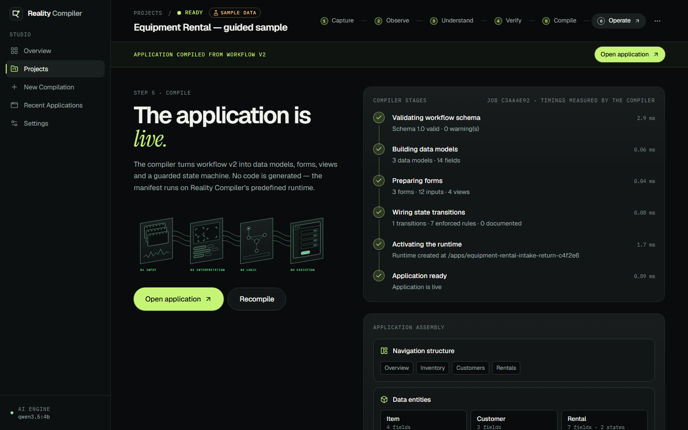
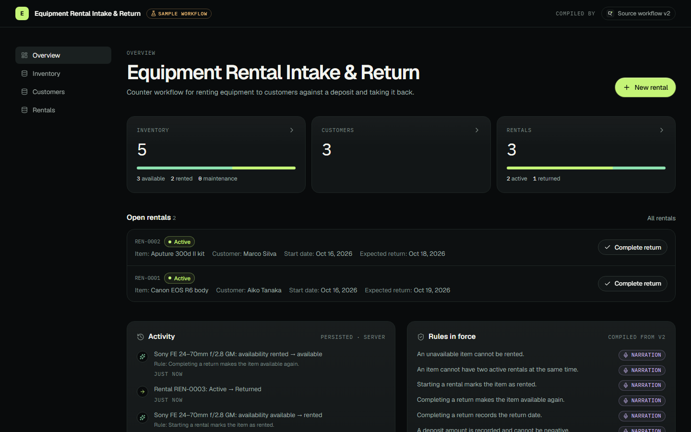
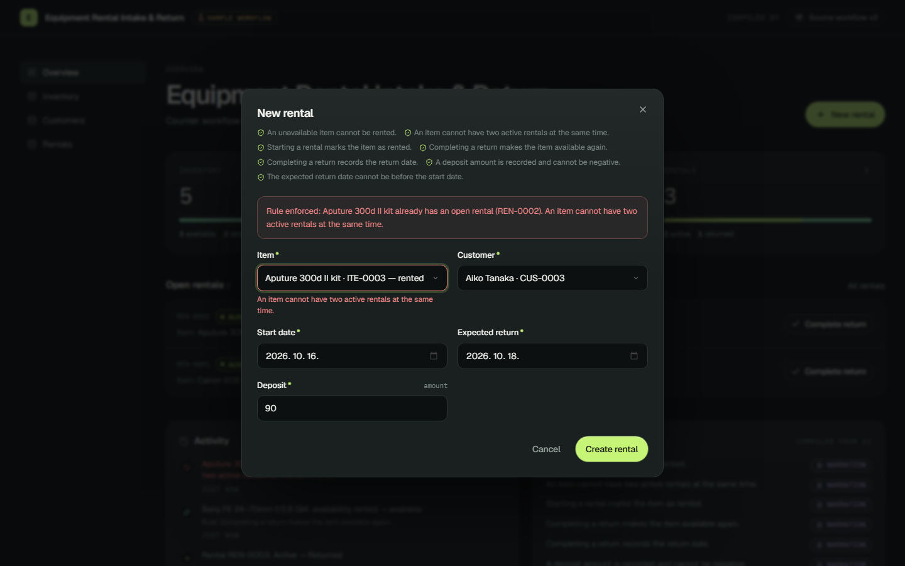
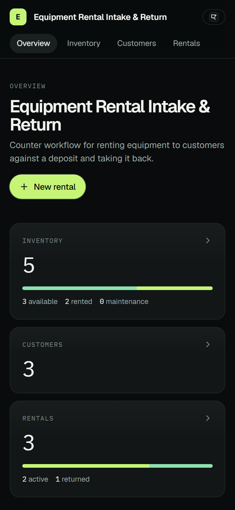

# Reality Compiler

**From reality to runnable software.**
*Don't describe your workflow. Show it.*

Reality Compiler turns a recorded business process into a working application. You record or upload a short demonstration of how work is done. A local open-weight AI model proposes the process structure: entities, states, actions and business rules, each traced back to the second of the recording it came from. A person confirms or corrects every finding. The approved workflow then compiles into a schema-driven application that actually runs: records persist, and the server enforces the business rules on every operation.



## Screenshots

| | |
| --- | --- |
|  |  |
| **Understand**: evidence on the left, structure in the center, inspector on the right. Selecting a rule highlights the narration it came from. | **Verify**: nothing compiles until a person confirms or rejects each finding. |
|  |  |
| **Compile**: real stage results with measured timings, plus the assembly built from the manifest. | **Operate**: the generated app, with records persisted on the server. |
|  |  |
| **Rules are enforced server-side**: renting an item twice is refused, and the reason names the rule. | **Responsive**: Studio and generated apps adapt down to 390px. |

Regenerate the screenshots with `node scripts/screenshots.mjs` from `frontend/` while both dev servers are running.

---

## Why this is different

| Typical "AI app builder" | Reality Compiler |
| --- | --- |
| Starts from a written prompt or spec | Starts from **evidence of real work**: video, speech, narration |
| AI output is treated as the answer | AI output is a **proposal**. Every item is pending until a human confirms it |
| Generates and runs code | Produces a **constrained, validated definition** that a predefined runtime interprets. No model-generated code is ever executed |
| Rules live in prose | Rules compile into **server-enforced guards, invariants and effects** |
| No provenance | **Evidence Intelligence**: each rule links to its transcript segment or video frame, with an audit trail of human decisions |

## What works today

- **Cinematic landing page** with a deterministic hero animation of the core idea (reality → understanding → software), a scroll-driven narrative, and an **interactive in-page rental preview**. The preview runs the same rule kinds in the browser on throwaway data, and is labelled as such.
- **Studio**: overview, projects, a guided creation flow, recent applications, and an engine/settings page that reports live backend status.
- **Capture**: drag-and-drop upload with client and server validation (container magic bytes, size, duration), upload progress with cancel, preview, remove/replace, **browser recording** (camera or screen plus microphone) with permission and error handling, an optional written narration, a privacy notice, and transcript editing.
- **Observe**: a real background job with persisted stages: media received → audio extraction → transcription → frame sampling → model interpretation (two passes) → structured validation. The UI shows exactly what the backend reports. There are no invented percentages or time estimates.
- **Understand**: a three-panel workspace. Evidence (video or storyboard, frames, transcript) on the left, workflow structure (process canvas, entities, lifecycle, rules, actions, open questions) in the center, and a contextual **inspector** with structured editors on the right. Edits auto-save as new workflow versions.
- **Verify**: review every finding (confirm, reject, or reopen) and approve. Approval is refused server-side while anything is pending or invalid.
- **Compile**: a real compiler with six measured stages. The **application assembly** panel is built from the compiled manifest.
- **Operate**: the generated app at `/apps/:slug` has a dashboard, a list for each entity (table on desktop, cards on mobile), generated create and edit forms, a detail view with history, guarded transitions with confirmation, an activity feed that includes rule rejections, sample-data seeding, and a clear-data action behind a confirmation dialog.
- **Evidence & audit page**: an evidence index for every cited finding, and an audit trail of model, compiler and reviewer actions.

### The first supported workflow: equipment rental

Inventory (name, type, availability, notes), customers (name, email, phone) and rentals (item, customer, start date, expected return, deposit, status, returned-on date). The server enforces these rules:

1. An unavailable item cannot be rented (`ref_field_equals` guard).
2. An item cannot have two active rentals (`exclusive_reference` invariant).
3. Starting a rental marks the item as rented (`set_ref_field` effect).
4. Completing a return makes the item available again (`set_ref_field` effect).
5. Completing a return records the return date (`set_field` effect).
6. A deposit cannot be negative (`min_value`). The expected return can't be before the start date (`date_order`).
7. Invalid state transitions are rejected with HTTP 409. Workflow-owned fields (state, effect targets, locked references) can't be edited by hand.

The same runtime runs **any** workflow that compiles. The AI pipeline was tested on a different domain (a tool-lending workshop), and the workflow editor can define new ones by hand.

## Two demo paths

**Path A: Instant guided demo (no AI model needed).** Choose *Experience the Demo* on the homepage or Studio. This loads a **predefined example**: a narrated rental-counter walkthrough shown as an illustrated storyboard, with an authored workflow. The UI marks it "Sample data" everywhere and never presents it as model output. Review it, compile it, operate it.

**Path B: Analyze my workflow.** Upload or record real media. The backend runs FFmpeg, faster-whisper and a local Ollama model. If the model is unavailable, or its answer can't be mapped to a supported workflow, the job fails and says why, and you can retry or continue from the rental template or a blank workflow.

## Architecture

```
Observed process (video · speech · narration)
   │  FFmpeg: probe, extract 16 kHz audio, sample N frames
   │  faster-whisper: timestamped transcript (editable)
   ▼
Model (Ollama-compatible, open-weight, multimodal)
   │  Pass A  (frames + numbered source segments) → entities, fields, lifecycle, steps, questions
   │  Pass B  (text; JSON schema generated from Pass A) → rules (one schema per rule kind), actions
   ▼
Normalization (untrusted input)   keys re-derived · references checked · citations → timestamps/quotes
   ▼                              unmappable rules downgraded to documented notes · everything "pending"
Workflow definition v1..n (Pydantic / Zod)  ── human review, edits, audit trail ──▶ approval
   ▼
Compiler  validate_schema → build_models → prepare_forms → wire_transitions → activate_runtime → ready
   ▼
Manifest (pure data)  ──▶  Predefined runtime  (closed set of rule kinds, per-app write lock, event log)
   ▼
Generated application  /apps/:slug   (records persisted in SQLite)
```

**Safety by construction.** The model only ever produces JSON constrained by a schema. That JSON is normalized, validated, reviewed and compiled into a manifest. The runtime interprets a *closed* set of parameterized rule kinds (`ref_field_equals`, `exclusive_reference`, `set_ref_field`, `set_field`, `min_value`, `date_order`, plus non-enforced `note`). No Python, JavaScript, SQL or shell from a model or a workflow definition is ever executed.

### Repository layout

```
backend/
  app/
    main.py                FastAPI app, error handling, capabilities
    config.py              environment configuration (RC_*)
    db.py                  SQLAlchemy models (projects, media, workflow versions, jobs, apps, records, events, audit)
    api/projects.py        projects, media upload/stream, transcript, analysis, workflow versions, approval, compile, audit
    api/apps.py            generated application runtime API
    pipeline/media.py      FFmpeg probing, audio extraction, frame sampling, container sniffing
    pipeline/transcribe.py faster-whisper
    pipeline/model.py      Ollama provider, two-pass constrained extraction
    pipeline/normalize.py  untrusted output → reviewable workflow definition
    workflow/schema.py     the workflow definition (Pydantic)
    workflow/validation.py semantic validation and review gating
    workflow/compiler.py   definition → manifest
    workflow/runtime.py    manifest interpreter with rule enforcement
    workflow/sample.py     predefined sample and rental template (always labelled)
    services/jobs.py       background analysis and compile jobs with persisted stages
  tests/                   pytest: core workflow, rules, uploads, pipeline failure, normalization
frontend/
  src/pages/               Landing, Studio pages, project steps, generated app
  src/components/          design system, studio (CompilerCore, WorkflowCanvas, Inspector, Evidence, Capture), app runtime UI
  src/lib/                 API client, Zod workflow schema, queries, workspace store
  e2e/                     Playwright: full guided journey, smoke tests on desktop and mobile
docs/demo-script.md        60–90 s jury walkthrough
```

### Technical stack

- **Frontend:** React 19, TypeScript, Vite, Tailwind CSS v4, React Router, Motion for React, TanStack Query, Zustand, React Hook Form, Zod, Lucide icons, Geist / Instrument Serif / IBM Plex Mono (self-hosted via Fontsource)
- **Backend:** Python 3.12, FastAPI, Pydantic v2, SQLAlchemy 2, SQLite (WAL), FFmpeg via `imageio-ffmpeg` (or system FFmpeg), faster-whisper, Ollama HTTP API
- **AI model used in development and testing:** `qwen3.5:4b` via Ollama, an open-weight model that reports vision capability. Any Ollama model can be configured. The backend checks that the model is installed and whether it supports vision, then adapts or reports the problem.
- **Tests:** pytest, Vitest and React Testing Library, Playwright

## Setup (Windows PowerShell)

Prerequisites: Python 3.11+ (3.12 tested), Node.js 20+ (24 tested), and optionally [Ollama](https://ollama.com) for Path B.

```powershell
# 1. Backend
cd backend
python -m venv .venv
.\.venv\Scripts\python.exe -m pip install --upgrade pip
.\.venv\Scripts\python.exe -m pip install -r requirements.txt
.\.venv\Scripts\python.exe -m uvicorn app.main:app --host 127.0.0.1 --port 8000
```

```powershell
# 2. Frontend (second terminal)
cd frontend
npm install
npm run dev
```

Open http://localhost:5173. The Vite dev server proxies `/api` to the backend.

```powershell
# 3. Optional, for Path B: a local multimodal model
ollama pull qwen3.5:4b
# then check Studio → Settings shows the model as installed with vision
```

Configuration is optional: copy `.env.example` to `.env` and adjust the `RC_*` variables (model, Ollama URL, limits, Whisper model, FFmpeg path). FFmpeg doesn't need a separate install, because `imageio-ffmpeg` ships a binary. The first transcription downloads the faster-whisper weights (`base`, about 145 MB) from Hugging Face.

macOS/Linux: use `.venv/bin/python` instead of `.\.venv\Scripts\python.exe`.

## Running the guided demo

1. Start both servers and open http://localhost:5173.
2. Click **Experience the Demo**.
3. Play the storyboard and click a rule to see its cited narration highlighted.
4. Click **Confirm N with evidence**, then **Verify & approve**. Decide the remaining AI inferences (reject "Late returns may incur a fee"), then **Approve workflow**.
5. Click **Compile Application**, then **Open application**.
6. Click **Add sample records**. Create a rental for the Canon EOS R6, and its availability flips to *rented*. Try renting it again, and the server refuses. Click **Complete return**, and the item is available again. Reload the page: everything persists.

## Running AI processing (Path B)

1. Make sure Ollama is running and the configured model is installed (Studio → Settings).
2. Studio → **New Compilation**: upload a short clip (MP4/MOV/WebM/MKV, ≤ 200 MB, ≤ 5 min) or record your camera or screen, and optionally add a narration.
3. Click **Upload and analyze** and watch the real job stages. On a laptop CPU/GPU, `qwen3.5:4b` took about 6.5 minutes of model time for a 48-second clip in our tests (two constrained passes; the second, with the rule grammar, is the slower one). Larger models are slower but more accurate.
4. Review the proposal in the workspace. Items the model cited show their transcript quote and timestamp, and claims of direct evidence without a citation are downgraded to *AI inference*. Correct whatever is wrong, approve, and compile.

### Choosing a model

The default is `qwen3.5:4b`, a good fit for a laptop without a dedicated GPU (development machine: Intel Core Ultra 7 155U, 15 GB RAM, CPU inference). There, one analysis takes several minutes, and the model gets entities and lifecycles right more reliably than rules. On a machine with a GPU with 12 GB+ VRAM, or plenty of RAM and patience, a larger vision model from the Ollama library gives better rule mapping:

```powershell
ollama pull <larger-vision-model>              # any Ollama model whose capabilities include "vision"
$env:RC_OLLAMA_MODEL = "<larger-vision-model>" # or set RC_OLLAMA_MODEL in .env
```

Studio → Settings shows whether the configured model is installed and has vision. Expect roughly 2× the analysis time per doubling of parameters on CPU. The guided demo (Path A) doesn't use a model at all.

## Testing

```powershell
cd backend;  .\.venv\Scripts\python.exe -m pytest -q          # 10 tests: rental cycle, rules, uploads, failure handling, normalization
cd frontend; npm run typecheck                                 # TypeScript (tsc -b)
cd frontend; npm test                                          # 9 Vitest tests: schema helpers, workflow ops, SchemaForm
cd frontend; npx playwright install chromium; npm run test:e2e # 15 Playwright tests: full guided journey + desktop/mobile smoke
```

Playwright starts its own backend (:8001, temporary data directory) and Vite server (:5174), so tests never touch your development data.

## Limitations (honest)

- **Model quality depends on the model you run.** With a 4B model, extraction of entities and lifecycles is usually good, but rule mapping is less consistent. Rules that can't be mapped to an enforceable kind are kept as documented notes for you to fix in the inspector. Nothing is compiled without human review.
- **Transcription is English-first** with the default `base` Whisper model. Choose a larger or multilingual model with `RC_WHISPER_MODEL`.
- **Rule language is intentionally small:** preconditions on linked records, exclusivity, effects, minimums and date order. Arbitrary logic such as fees or calculations is recorded as notes, not enforced.
- **Single-process deployment.** Rule checks are serialized per application with an in-process lock. Running several backend workers would need database-level locking.
- **Recompiling** updates the manifest in place and keeps existing records. Removing a field leaves the old values stored but hidden.
- Jobs don't survive a server restart. Interrupted jobs are marked failed and can be retried.
- There is no authentication or multi-user support. This is a local, single-user build.
- The sample's "video" is an illustrated storyboard with an example narration, not a camera recording, and it's labelled as such.

## Security & privacy

- Uploads are checked by magic bytes, not by the file name or MIME type the client sends. They're size-limited while streaming and duration-limited after probing, and stored under server-generated names (the original name is display metadata only, so path traversal isn't possible).
- FFmpeg is invoked with argument lists, never through a shell.
- Model output, transcripts and workflow definitions are treated as untrusted. They're validated with Pydantic on the server and Zod in the client, and interpreted by a closed runtime.
- CORS is restricted to the configured origins. No secrets are stored in the frontend, and configuration comes from environment variables.
- Media and derived frames stay on your machine. Frames and text are sent only to the model server you configure. Deleting a project deletes its media, frames, workflow versions, audit trail and compiled application.

## Roadmap

- Multi-workflow templates (work orders, inspections, intake forms) and composite rules (`all/any`)
- Calculated fields and fee rules with an explicit, sandboxed expression language
- Model comparison: run two models and diff their proposals side by side
- Timeline view correlating every detected step with the video
- Role-based access, multi-user review, and export of compiled apps as standalone services
- Postgres support with row-level locking for multi-worker deployments

---

See [docs/demo-script.md](docs/demo-script.md) for the 60–90 second jury walkthrough.
